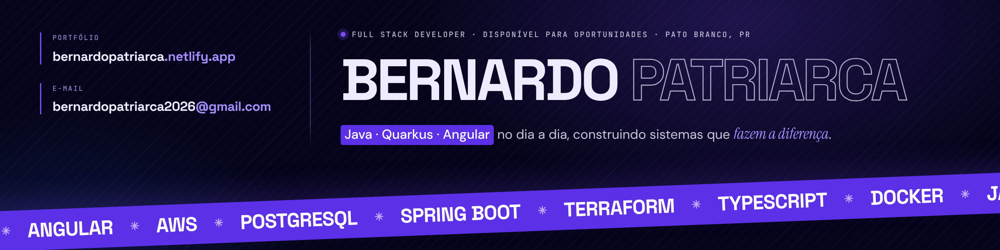

<div align="center">



# Portfólio — Bernardo Patriarca

**Site pessoal de um desenvolvedor full stack.** Sem framework e sem build: HTML, CSS modular e JavaScript em ES Modules, com WebGL puro na abertura.

[**Ver ao vivo →**](https://bernardopatriarca.netlify.app)


</div>

---

## O que tem aqui

| | |
| --- | --- |
| **Abertura em WebGL2** | Um vórtice abre do centro até as bordas e revela a marca com glitch e franjas magenta/ciano. Shader escrito à mão, sem biblioteca. |
| **Corredor 3D dos projetos** | Uma sala ladrilhada em perspectiva onde as telas reais dos projetos flutuam em profundidades diferentes. A rolagem é o trilho da câmera. |
| **"A máquina"** | A estrutura 3D atrás do processo ganha uma camada por etapa: nuvem de pontos → núcleo → gaiola → anel em órbita. |
| **Tema claro e escuro** | Alternância com transição suave, preferência salva no `localStorage`. Toda a paleta sai de custom properties — inclusive a dos shaders. |
| **Paleta de comandos (⌘K)** | Busca de seções e ações sem tirar a mão do teclado. |
| **Terminal interativo** | Um terminal de verdade no navegador: `about`, `skills`, `projects`, `neofetch`, `matrix`, `goto <seção>`, `open <projeto>` — 25 comandos, com histórico e autocomplete no Tab. |
| **GitHub ao vivo** | Repositórios, linguagens e atividade puxados da API pública do GitHub em tempo real — nada chumbado no HTML. |
| **Movimento com propósito** | Scroll suave, parallax, reveal na entrada, letras-fantasma, cursor customizado e marquee — tudo desligado sob `prefers-reduced-motion`. |
| **Responsivo de verdade** | Layout repensado em cada breakpoint, não só encolhido. Nenhuma rolagem lateral a 375px. |

## Rodando local

Precisa de um servidor HTTP — ES Modules não carregam via `file://`.

```bash
git clone https://github.com/BernardoPatriarca/meu-portfolio.git
cd meu-portfolio
python3 -m http.server 4173
```

Abra <http://localhost:4173>. Não tem `npm install`, não tem passo de build: o que está no repositório é exatamente o que vai pro ar.

## Estrutura

```
index.html                 marcação de todas as seções
assets/
├── img/                   foto do hero, telas dos projetos e o banner do README
├── banner/                fonte do banner (HTML) e o script que o renderiza
├── css/
│   ├── main.css           importa todo o resto, nesta ordem
│   ├── base/              tokens, reset, tipografia, layout
│   ├── components/        nav, menu, botão, cursor, terminal, ⌘K, marquee...
│   ├── sections/          abertura, hero, sobre, processo, corredor, contato...
│   └── utils/             reveal, letras-fantasma, responsivo, reduced-motion
└── js/
    ├── main.js            inicializa tudo
    ├── core/              dom, config, loop de rAF, smooth scroll
    ├── components/        preloader, abertura WebGL, corredor 3D, "a máquina", ⌘K...
    └── effects/           parallax, reveal, letras-fantasma, marquee, processo...
```

Um arquivo por responsabilidade, tanto no CSS quanto no JS. Nada de `style.css` de 3000 linhas.

## Decisões de arquitetura

**Um loop de animação só.** Todo efeito de scroll passa por `core/raf.js`. Os módulos registram callbacks com `onScroll` (roda quando o scroll muda) ou `onFrame` (roda todo frame), em vez de criar seus próprios `requestAnimationFrame` — um `rAF` por página, não um por efeito. O loop também dorme com a aba em segundo plano.

**Conteúdo em um lugar.** O que muda com frequência — e-mail, redes, projetos, usuário do GitHub — fica em `core/config.js`. As telas dos projetos ficam no HTML de cada linha, e tanto o preview flutuante quanto os painéis do corredor leem de lá: um caminho de imagem, um lugar.

**Tema por token.** Tudo vem de custom properties em `base/tokens.css`. `--accent` é para detalhe gráfico; `--accent-surface` é para bloco com texto por cima. Nenhum componente escreve cor literal — nem os shaders, que leem as mesmas variáveis em tempo de execução.

**Movimento é opcional.** `utils/reduced-motion.css` e a flag `reduced` em `core/dom.js` desligam animação, parallax e as cenas 3D para quem pediu menos movimento no sistema.

## Efeitos em WebGL

**Abertura (`components/intro-gl.js`).** WebGL2 puro, sem biblioteca: um shader de fragmento em tela cheia. A sequência é um vórtice que nasce no centro e abre até as bordas — crista e marolas entortando o espaço, como pedra na água — e só depois a marca se revela por dissolução, com glitch e franjas em magenta/ciano. A marca é a constante `WORDS` (uma entrada por linha; o corpo se ajusta sozinho); o `<h1>` do HTML continua com o nome completo, para leitores de tela e SEO.

**Corredor dos projetos (`components/work-corridor.js`).** Chão, teto e duas paredes ladrilhadas, com as telas reais dos projetos nos painéis e as letras do nome fantasmeadas nas paredes. A seção tem 360svh e o palco fica preso com `position: sticky`: **a rolagem é o trilho da câmera**. A velocidade do scroll inclina a câmera e abre a lente. O projeto marcado com `data-feature` no HTML fecha o corredor — painel maior, de frente, com selo e halo atrás.

**"A máquina" (`components/process-3d.js`).** A estrutura atrás das etapas do processo ganha uma camada por etapa: nuvem de pontos (descoberta) → núcleo (planejamento) → gaiola geodésica (desenvolvimento) → anel em órbita com marcos (entrega) → acende inteira.

**Tema claro.** O shader da abertura não apaga os efeitos no claro: a função `lay()` troca de modo. No escuro soma luz; no claro deposita tinta colorida sobre o papel. É isso que mantém o roxo e o azul em vez de virar preto no branco.

## Degradação

Nenhum efeito é necessário para ler o site:

| situação | abertura | corredor |
| --- | --- | --- |
| sem WebGL2 | `<h1>` visível + grid em CSS | faixa de cards |
| CDN do Three.js fora | — | faixa de cards (a seção nunca fica alta à toa) |
| `prefers-reduced-motion` | um quadro parado | faixa de cards, sem transição |
| toque / celular | animação normal, canvas menor | faixa de cards; Three.js nem é baixado |

O estado base do corredor **é** a faixa de cards: o trilho de 360svh só entra quando o 3D vai mesmo rodar, decidido de forma síncrona antes da primeira pintura — assim uma falha de rede nunca deixa 3000px de rolagem vazia.

O canvas da abertura limita o `devicePixelRatio` (2 no desktop, 1.5 no toque) e tem teto de pixels (2,3 MP / 1,2 MP). O corredor e "a máquina" limitam o pixel ratio em 2 e só desenham enquanto estão em tela.

## Notas

- O CSS usa `@import`, que carrega em cascata. Em produção com muita latência, vale concatenar os arquivos em um só.
- `assets/js/components/terminal/commands.js` concentra os comandos do terminal — basta adicionar uma chave ao objeto para criar um novo.
- Cuidado com `clip-path` e `mask-image` em elemento observado por `IntersectionObserver`: recortar o elemento zera a área medida, o callback não dispara e o conteúdo some. Nas duas vezes que isso aconteceu aqui — barra de idioma e linha de projeto — a saída foi mover o recorte para um pseudo-elemento.
- O banner do topo não é uma imagem solta: ele nasce de `assets/banner/banner.html`, que repete os tokens do tema escuro. Mudou a paleta em `base/tokens.css`? Espelhe lá e rode `node assets/banner/render.mjs` (precisa de Playwright com Chromium) para regerar `assets/img/banner.png`.
- Única dependência externa: Lenis (scroll suave) e Three.js, ambos via CDN com versão fixa. Three.js é baixado sob demanda e só no desktop.

## Contato

[Site](https://bernardopatriarca.netlify.app) · [LinkedIn](https://www.linkedin.com/in/bernardopatriarca/) · [GitHub](https://github.com/BernardoPatriarca) · [E-mail](mailto:bernardopatriarca2026@gmail.com)
